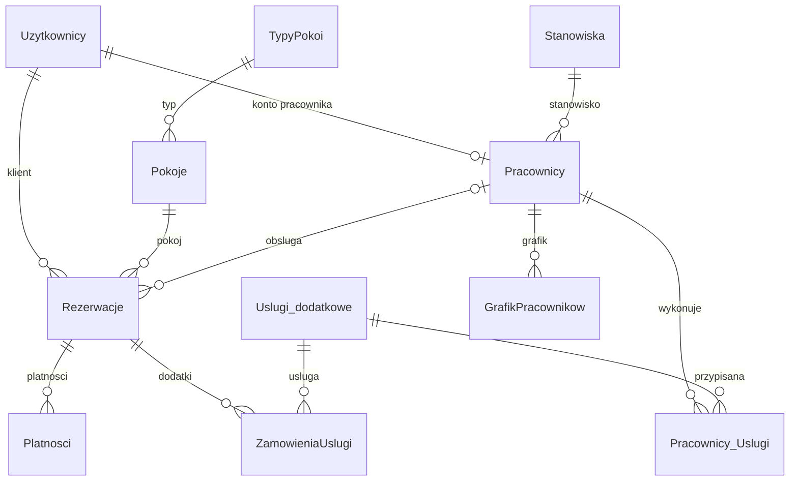

# Schemat relacji bazy Grand Access Hotel

`Pracownicy_Uslugi` tworzy relację N:M. `Proby_logowania` przechowuje próby według adresu e-mail i nie ma klucza obcego do `Uzytkownicy`, aby rejestrować także próby dla nieznanych adresów. Definicje kolumn i ograniczeń znajdują się w `database.sql`.
