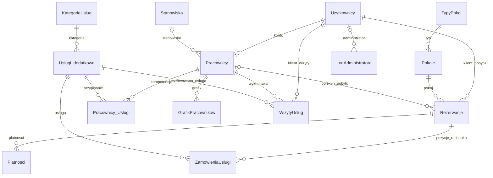

# Schemat bazy — wersja 2, etapy 1–3

Aktualny diagram: [diagram.png](diagram.png), [SVG](diagram_etap3.svg). Źródło Graphviz: `diagram_etap3.dot`. Obraz wygenerowano z rzeczywiście zmigrowanej bazy, nie tylko z planu tabel.

## Trzy rozdzielone pojęcia

1. `Rezerwacje`: pobyt w pokoju. Pracownik jest opcjonalnym opiekunem/recepcjonistą, nie zasobem zajętym przez cały pobyt.
2. `ZamowieniaUslugi`: pozycja rachunku pobytu, ilość i historyczna cena jednostkowa.
3. `WizytyUslug`: termin konkretnej usługi dla klienta u pracownika — **trzy obowiązkowe FK**, początek/koniec, cena historyczna, status, uwagi i licznik wersji.

To usuwa ryzyko, że wymaganie etapu 1 „rezerwacja klient–pracownik–usługa” jest realizowane wyłącznie pośrednio przez rachunek pokoju.

## Normalizacja i integralność

- Po migracji 004 usługa ma **tylko FK `ID_Kategorii`**, bez zdublowanego tekstowego `Kategoria`. W starych plikach migracyjnych pole występuje jedynie jako źródło przenoszonych danych, nie jako końcowy projekt bazy.
- `Cena` wizyty i `Cena_jednostkowa` zamówienia to historyczne wartości transakcji; zmiana cennika ich nie przelicza. To uzasadniona migawka, nie zbędna kopia aktualnej ceny.
- N:M kompetencji ma złożony PK. Konto pracownika jest UNIQUE względem profilu. Grafik ma UNIQUE(pracownik, data).
- CHECK: koniec po początku, dodatnia ilość i liczba osób, nieujemne kwoty/ceny, czas 1–1440 minut oraz spójność godzin grafiku z rodzajem dnia.
- Dzień Praca wymaga godzin od < do; urlop/wolne/zwolnienie nie mają godzin. Jeden przedział pracy na dzień; brak obsługi nocnych zmian w tej wersji.
- Kategoria z usługami, usługa z zamówieniami/wizytami i pracownik z rezerwacjami/wizytami nie są fizycznie usuwani. UI zaleca dezaktywację; FK chroni bazę również przed obejściem interfejsu.
- Pracownik bez historii może zostać usunięty: grafik i N:M usuwają się kaskadowo, konto pozostaje klientem.
- Konflikt wizyt: `stary_od < nowy_do AND stary_do > nowy_od`, z pominięciem anulowanych i zakończonych. Tworzący wizytę admin blokuje rekord pracownika przed kontrolą/zapisem. MySQL samym zwykłym CHECK nie potrafi wykryć konfliktów pomiędzy wieloma wierszami.
- Role kont, aktywność, kompetencje i zgodność terminu z grafikiem sprawdza dodatkowo serwer PHP. FK nie sprawdza wartości kolumny Rola w tabeli nadrzędnej.

## Indeksy i tabele techniczne

- Wizyty: `(ID_Pracownika, DataOd, DataDo)` do konfliktów, `(Status,DataOd)` do list i `(ID_Klienta,DataOd)` do przyszłego panelu klienta.
- Log: czas oraz obiekt+ID; próby logowania: e-mail+czas; pobyty: przedziały dat; pozostałe FK mają indeksy bazowe.
- `Migracje`: bez FK, rejestruje wykonane 003 i 004.
- `Proby_logowania`: bez FK, bo może rejestrować nieznane e-maile.
- `LogAdministratora`: administrator nullable; obiekt/ID bez FK, aby historia przeżyła usunięcie obiektu. Nie jest to niezmienialny kryptograficzny audyt.

Definicje: pełny `database.sql` (destrukcyjny przy odtwarzaniu), migracje zachowujące istniejące dane przez `scripts/migrate_etap3.php`.
